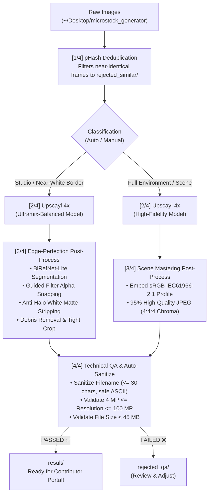

# Microstock Generator 🚀

[](https://www.python.org/)
[](#quick-start-zero-coding-required)
[](#microstock-compliance-cheat-sheet)
[](LICENSE)

An automated, **100% local and offline** production pipeline that converts raw photos, illustrations, and AI-generated artwork into commercial stock assets ready for instant submission to **Adobe Stock, Shutterstock, Freepik, Getty Images / iStock, Vecteezy**, and more.

> 💡 **Designed for Everyone:** Run bulk batches with a single double-click (no coding needed) or automate advanced workflows with flexible CLI flags.

---

## 📑 Table of Contents
1. [Core Capabilities](#core-capabilities)
2. [4-Stage Processing Pipeline](#4-stage-processing-pipeline)
3. [Quick Start (Zero Coding Required)](#quick-start-zero-coding-required)
4. [Folder Structure Workflows](#folder-structure-workflows)
5. [Power User & Command-Line Usage](#power-user--command-line-usage)
6. [Configuration (`config.yaml`)](#configuration-configyaml)
7. [Microstock Compliance Cheat-Sheet](#microstock-compliance-cheat-sheet)
8. [Troubleshooting & FAQ](#troubleshooting--faq)
9. [License](#license)

---

## Core Capabilities

Submitting raw assets directly to microstock agencies often causes rejections due to white fringes, wrong color spaces, or non-compliant dimensions. Microstock Generator automates complete technical compliance:

- ✂️ **True Anti-Halo Cutouts:** Combines BiRefNet-Lite segmentation, edge-aware Guided Filtering, and mathematical color de-contamination (un-premultiplication) to permanently eliminate white halos on isolated PNGs.
- 🎨 **Smart Auto-Classification:** Inspects image borders to automatically route studio assets to transparent PNGs and complex environments to sRGB JPEGs.
- ⚡ **AI Super-Resolution:** Integrates with local Upscayl 4x models to guarantee 4 MP – 100 MP microstock standards without cloud fees or quality loss.
- 🛡️ **Auto-Sanitization & QA Guard:** Sanitizes messy filenames to safe alphanumeric characters ($\le 30$ chars), enforces file size limits ($< 45$ MB), embeds sRGB IEC61966-2.1 ICC profiles, and deduplicates frames via pHash.
- 🔒 **100% Offline & Private:** Zero external API calls for processing. Your original intellectual property never leaves your local hardware.

---

## 4-Stage Processing Pipeline

The pipeline mirrors the exact 4-stage execution logged in the terminal:



---

## Quick Start (Zero Coding Required)

### Step 1: Install Prerequisites (One-Time Setup)

1. **Python 3.10, 3.11, or 3.12:**
   - **macOS:** Download from [python.org](https://www.python.org/) or install via `brew install python@3.11`.
   - **Windows:** Download from [python.org](https://www.python.org/).  
     *(⚠️ Make sure to check **"Add python.exe to PATH"** during installation).*
   - **Linux:** Install via package manager (`sudo apt install python3 python3-venv python3-pip`).

2. **Upscayl (Free AI Super-Resolution):**
   - Download the installer from [upscayl.org](https://www.upscayl.org/).
   - The engine automatically detects Upscayl in default OS application directories.  
     *(Optional: Pass `--skip-upscale` if your images already exceed 4 MP or your machine lacks a GPU).*

---

### Step 2: 1-Click Launch

| Operating System | Launcher File | Action |
|---|---|---|
| **macOS** | `Run_Microstock_Generator.command` | Double-click to run *(Right-click → Open on first run)* |
| **Windows** | `run.bat` | Double-click to run |
| **Linux** | `run.sh` | Run `./run.sh` in terminal |

> 🪄 **Self-Healing Environment:** Launchers automatically create, verify, and maintain their local virtual environment (`.venv`). If you ever rename or move the project folder, the launcher automatically fixes stale paths without manual intervention.

---

### Step 3: Place Images & Collect Results

1. On first launch, the app creates your desktop workspace:
   ```text
   ~/Desktop/microstock_generator/
   ```
2. Place raw images into `~/Desktop/microstock_generator/` (or inside batch subfolders).
3. Run the launcher again.
4. Retrieve your validated assets directly from the generated **`result/`** folder!

---

## Folder Structure Workflows

Microstock Generator automatically accommodates two organizational styles:

### Workflow A: Single-Folder Mode (Fastest)
Place raw images directly into the main desktop folder:
```text
~/Desktop/microstock_generator/
├── Run_Microstock_Generator.command    # Auto-generated desktop launcher
├── Run_Microstock_Generator.bat        # Auto-generated Windows shortcut
├── portrait.jpg                        # Raw input image
├── product_photo.png                   # Raw input image
└── result/                             # 🏁 Validated production assets
    ├── portrait.jpg                    # Full-scene mastered sRGB JPEG
    └── product_photo.png               # Clean transparent PNG cutout
```

### Workflow B: Batch Subfolder Mode (Organized by Themes)
Group projects or prompt collections into individual thematic subfolders:
```text
~/Desktop/microstock_generator/
├── watercolor_animals/
│   ├── raw/                            # Input images (auto-organized on launch)
│   ├── rejected_similar/               # Filtered duplicate frames (pHash)
│   ├── rejected_qa/                    # Any file failing technical specs
│   └── result/                         # 🏁 Finished assets for this batch
│
└── architectural_interiors/
    ├── raw/
    └── result/
```

---

## Power User & Command-Line Usage

Use `python main.py` directly for headless servers, scripts, or external storage:

### 1. Verification (Dry Run)
Inspect system detection, binary paths, and config without modifying files:
```bash
python main.py --dry-run
```

### 2. Custom Input and Output Folders
Process files from external drives or custom directories:
```bash
python main.py --input /Volumes/ExtremeSSD/RawPhotos --output /Volumes/ExtremeSSD/ApprovedStock
# Short aliases:
python main.py -i ./my_photos -o ./my_results
```

### 3. Background Removal Control
```bash
# Keep original backgrounds for all images (treat all assets as scenes):
python main.py --no-remove-bg

# Save an extra copy of transparent cutouts to a dedicated directory:
python main.py --bg-output ~/Desktop/Transparent_Cutouts
```

### 4. Bypass AI Upscaling
Process images at original resolution (applies background removal, anti-halo cleaning, and QA validation):
```bash
python main.py --skip-upscale
```

### 5. Force Output Asset Type
```bash
python main.py --type isolated    # Force transparent PNG output
python main.py --type scene       # Force sRGB JPEG output
```

### CLI Flag Reference

| Option | Shorthand | Default | Purpose |
|---|---|---|---|
| `--input` | `-i`, `--source`, `-s` | `~/Desktop/microstock_generator` | Source directory with images or batch folders. |
| `--output` | `-o`, `--result`, `-r` | `<batch>/result/` | Target folder for validated outputs. |
| `--remove-bg` | | `Enabled` | Enable AI studio cutout on isolated objects. |
| `--no-remove-bg` | `--skip-bg-remove` | | Disable background removal; preserve backgrounds. |
| `--bg-output` | `--bg-output-dir` | `None` | Save duplicate transparent PNG cutouts here. |
| `--skip-upscale` | `--no-upscale` | `false` | Skip 4x AI upscaling step. |
| `--type` | `-t` | `auto` | Asset type: `auto`, `isolated` (PNG), or `scene` (JPEG). |
| `--dry-run` | | | Inspect paths, models, and binaries without running. |

---

## Configuration (config.yaml)

Fine-tune pipeline parameters in `config.yaml`:

```yaml
paths:
  base_dir: "~/Desktop/microstock_generator" # Default source folder
  output_dir: null                          # null saves to <batch>/result/
  upscayl_bin: null                         # Auto-detected if null
  models_dir: null                          # Auto-detected if null

upscaling:
  scale: 4
  skip_upscale: false
  models:
    isolated: "ultramix-balanced-4x"        # Crisp edges without plastic texture
    scene: "high-fidelity-4x"               # Rich photorealistic detail

segmentation:
  remove_bg: true                           # Set false to disable cutout globally
  bg_output_dir: null                       # Optional cutout export folder
  bg_model: "birefnet-general-lite"         # Fast SOTA segmentation model
  alpha_low_cut: 40                         # Eliminates faint floor shadows
  alpha_high_snap: 200                      # Locks subject core to 100% opacity
  color_decontaminate: true                 # Anti-halo un-premultiplication
  tight_crop: true                          # Crops empty transparent margins
  tight_crop_margin_pct: 0.03               # 3% breathing margin around subject
  auto_reupscale_if_under_4mp: true         # Guards against sub-4MP tight crops

validation:
  min_megapixels: 4.0                       # Adobe Stock strict minimum
  max_megapixels: 100.0                     # Adobe Stock strict maximum
  max_file_size_mb: 45.0                    # Agency file upload cap
  max_filename_chars: 30                    # Filename limit for contributor CSVs
  srgb_enforcement: true                    # Embeds sRGB IEC61966-2.1 ICC profile
  jpeg_quality: 95                          # High quality 4:4:4 chroma JPEG
  dedup_phash_threshold: 6                  # Duplicate rejection sensitivity
```

---

## Microstock Compliance Cheat-Sheet

| Agency | Core Technical Specifications | Pipeline Solution |
|---|---|---|
| **Adobe Stock** | 4 – 100 MP, $< 45$ MB, sRGB profile, zero edge halos. | Anti-halo un-premultiplication removes white fringes. Technical QA enforces resolution, file size, and filename constraints. |
| **Shutterstock** | Minimum 4 MP, no blur/fringing, 8-bit RGB/sRGB. | Upscayl 4x AI models ensure 4K+ sharpness with zero plastic artifacting. |
| **Freepik** | High aesthetic fidelity, clean cutouts, strict anti-spam. | pHash filtering rejects near-identical compositions; BiRefNet purges floating stray pixels. |
| **iStock / Getty** | Strict sRGB IEC61966-2.1 color profile, tight framing. | Automatic sRGB ICC embedding and 3% tight subject cropping. |

### 💡 Contributor Best Practices:
1. **Generative AI Disclosure:** On contributor portals, always check **"Created using generative AI tools"** for synthetic content.
2. **Releases:** Check **"People and Property are fictional"** when generating fictional human portraits or recognizable buildings.
3. **100% Zoom Check:** Always inspect a couple of sample outputs at 100% actual pixels before final submission.
4. **Metadata Cleanliness:** Avoid trademarked brand names (e.g., *iPhone*, *Sony*, *Lego*) or AI buzzwords (*"photorealistic"*, *"midjourney"*).

---

## Troubleshooting & FAQ

<details>
<summary><b>1. macOS: "Run_Microstock_Generator.command cannot be opened because it is from an unidentified developer"</b></summary>
<br>
macOS Gatekeeper blocks executable scripts downloaded from the web:
1. Open <b>System Settings > Privacy & Security</b>.
2. Scroll to the Security section and click <b>"Open Anyway"</b>.
3. Or grant executable rights via Terminal:
   ```bash
   chmod +x Run_Microstock_Generator.command run.sh
   ```
</details>

<details>
<summary><b>2. Windows: "'python' is not recognized as an internal or external command"</b></summary>
<br>
Python was installed without adding the executable to the system PATH:
1. Re-run the Python Windows installer.
2. Select <b>Modify</b>.
3. Check the box: <b>☑️ Add Python to PATH</b> and finish installation.
</details>

<details>
<summary><b>3. Upscayl binary is marked as MISSING in dry run</b></summary>
<br>
If Upscayl is installed in a non-standard directory:
1. Open `config.yaml`.
2. Specify the explicit path to your executable:
   - <b>macOS:</b> `/Applications/Upscayl.app/Contents/Resources/bin/upscayl-bin`
   - <b>Windows:</b> `C:\Program Files\Upscayl\resources\bin\upscayl-bin.exe`
   - <b>Linux:</b> `/usr/bin/upscayl-bin`
*(Or run with `--skip-upscale` if you don't require super-resolution).*
</details>

<details>
<summary><b>4. How do I re-process a batch that has already completed?</b></summary>
<br>
To prevent accidental file overwrites, folders containing an existing populated `result/` directory are skipped. To re-process:
- Delete or rename the existing `result/` folder inside that batch.
- Run the launcher again.
</details>

<details>
<summary><b>5. Virtual environment issues after moving or renaming the folder</b></summary>
<br>
Both `run.sh` and `run.bat` feature <b>automatic self-healing</b>. If a relocated directory breaks existing python interpreter paths, the script detects the issue and recreates `.venv` automatically. To trigger a manual reset at any time, simply delete the `.venv` directory.
</details>

---

## License

This project is licensed under the [MIT License](LICENSE).
