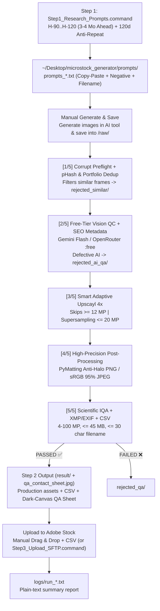

# Microstock Generator 🚀

[](https://www.python.org/)
[](#quick-start-1-click-launchers)
[](#microstock-compliance-cheat-sheet)
[](#free-tier-ai-setup-optional-0)
[](LICENSE)

A **$0 / Free-Tier Hybrid Microstock Automation Pipeline** that covers **high-demand seasonal research**, **commercial-grade prompt generation**, **Free-Tier Vision QC & ultra-specific Adobe Stock SEO metadata**, **4x AI super-resolution**, **anti-halo transparent cutouts**, **CSV/IPTC export**, **plain-text `.txt` run logs**, and **optional SFTP upload** for **Adobe Stock, Shutterstock, Freepik, Getty Images / iStock**, and more.

> 💡 **1-Click Hybrid Workflow (3 Launchers):** Double-click `Step1_Research_Prompts.command` to get copy-paste commercial prompts → generate & drop images into `<batch>/raw/` → double-click `Step2_Process_And_Metadata.command` for production-ready assets + `adobe_stock_metadata.csv` + auto-opened `qa_contact_sheet.jpg` → upload via Drag & Drop + `Upload CSV` (or `Step3_Upload_SFTP.command` when SFTP is unlocked). Offline analytics anytime: `./run.sh --report`.

---

## 📑 Table of Contents
1. [Core Capabilities](#core-capabilities)
2. [End-to-End Hybrid Workflow](#end-to-end-hybrid-workflow)
3. [Quick Start (1-Click Launchers)](#quick-start-1-click-launchers)
4. [Free-Tier AI Setup (Optional, $0)](#free-tier-ai-setup-optional-0)
5. [Folder Structure Workflows](#folder-structure-workflows)
6. [CLI Reference & Scheduled Automation](#cli-reference--scheduled-automation)
7. [Configuration (`config.yaml`)](#configuration-configyaml)
8. [Microstock Compliance Cheat-Sheet](#microstock-compliance-cheat-sheet)
9. [Security & Secret Protection](#security--secret-protection)
10. [Troubleshooting & FAQ](#troubleshooting--faq)
11. [License](#license)

---

## Core Capabilities

- 📈 **Step 1 — High-Demand Seasonal Research (`--research`):** Targets the **H-90 to H-120 buyer window** (what commercial buyers license **3–4 months ahead**), rotates across 24 evergreen commercial verticals daily, pulls live Google Trends RSS signals, prevents daily repeats via a **120-day rolling `prompt_history.json`** (exact + fuzzy Jaccard deduplication), enforces edge-safe isolated studio prompt rules (`#FFFFFF` zero-gradient backdrop, `100mm macro f/11` sharpness, opaque high-contrast subjects, zero shadows, plus matching `Negative Prompt`), and exports `Suggested File` (≤ 30 chars) into `~/Desktop/microstock_generator/prompts/`.
- 🧠 **Free-Tier Cloud AI Router ($0, Zero Credit Card):** Automatically routes text & vision tasks across free-tier providers with built-in RPM throttling, `certifi` SSL support (fixes macOS Python SSL errors), and automatic fallback (**Groq `openai/gpt-oss-120b` → `openai/gpt-oss-20b` → Gemini `gemini-3.8-flash` → Mistral → OpenRouter `:free`**), plus deterministic offline fallbacks when no API key is configured.
- ♻️ **Per-File Incremental Processing:** Tracks raw SHA-256 hashes in `result/manifest.json` so adding new images to an existing `raw/` folder only processes the **new** files, skips already-processed assets (saving Vision quota & GPU time), and appends cleanly to `adobe_stock_metadata.csv`.
- 🔍 **Single-Call Vision QC + Page-1 Adobe Stock SEO:** Audits raw AI images at 100% detail **before** upscaling (rejecting halos, messy shadows, pixel gaps, soft focus, plastic artifacts, bad hands, garbled text into `rejected_ai_qa/`) while simultaneously generating ultra-specific Titles (≤ 70 chars, no commas), 3-tier ranked Keywords (35–45, blocking generic filler spam), Category IDs (1–21), and SEO Filenames (≤ 30 chars).
- ✂️ **True Anti-Halo Cutouts + Pixel-Gap Sealing:** Combines BiRefNet-Lite segmentation, edge-aware Guided Filtering, Color-Projection Matting, **PyMatting Multi-Level Foreground Recovery (`estimate_foreground_ml`, MIT)**, interior pinhole sealing (`fill_interior_pinholes` to eliminate *celah pixel*), mathematical white-matte un-premultiplication, and embedded **sRGB IEC61966-2.1** ICC profiles on both transparent PNGs and JPEGs.
- ⚡ **Smart Adaptive Super-Resolution (16–20 MP Sweet Spot):** Integrates with local Upscayl 4x models (`ultramix-balanced-4x` / `high-fidelity-4x`) with a **hard watchdog timeout**, skips unnecessary upscaling when raw inputs are already `>= 12 MP`, and applies **Lanczos supersampling (`<= 20 MP`)** for razor-sharp 100% zoom and ~75% lower RAM usage.
- 🔬 **Scientific IQA + Dark-Canvas QA Sheet:** Evaluates every asset using `scikit-image` resolution-invariant blur (`blur_effect`), wavelet noise (`estimate_sigma`), and an isolated cutout **Halo Rim Detector**, plus exports `<batch>/qa_contact_sheet.jpg` over a charcoal `#181818` checkerboard for 10-second visual inspection (outside `result/`).
- 🛡️ **Portfolio Guard, Lossless Pure-Python XMP/EXIF & `--report`:** Prevents cross-batch *"Similar Content"* bans via `.portfolio_index.json` (pHash + Keyword Overlap Audit `<= 65%` + optional **OpenCLIP ViT-B-32** semantic audit), embeds Adobe Stock **XMP/EXIF** natively in pure Python even when ExifTool is absent (`adobe_stock_metadata.csv` + inline XMP), and provides `--report` offline portfolio analytics.
- 📤 **Step 5 — Optional SFTP Upload & Daily Scheduler:** Supports `sftp.contributor.adobestock.com` (Paramiko or system `curl` SFTP fallback) with anti-duplicate upload tracking and optional macOS `launchd` nightly scheduling.

---

## End-to-End Hybrid Workflow



---

## Quick Start (1-Click Launchers)

### Step 0: One-Time Prerequisites
1. **Python 3.10, 3.11, or 3.12** (`brew install python@3.11` on macOS).
2. **Upscayl** (free local 4x upscaler): Download from [upscayl.org](https://www.upscayl.org/) or `brew install --cask upscayl`.
3. *(Optional)* **ExifTool** for inline IPTC/XMP embedding: `brew install exiftool`.

### 1-Click Launchers (Codebase Root & Desktop)

| Step | 1-Click Launcher | What It Does |
|---|---|---|
| **Step 1** | `Step1_Research_Prompts.command` | Runs high-demand research, saves `prompts_*.txt` to `~/Desktop/microstock_generator/prompts/`, and opens it automatically for copy-paste. |
| *(Manual)* | *Generate & Save Raw* | Copy prompts into your AI generator and save raw PNG/JPG images into `<batch>/raw/`. |
| **Step 2** | `Step2_Process_And_Metadata.command` | Processes all `<batch>/raw/` folders (Dedup → Vision QC & SEO → Smart Upscayl → PyMatting Anti-Halo/sRGB → Scientific IQA → XMP + CSV + Dark QA Sheet + `.txt` log) with `caffeinate -i`, then opens `qa_contact_sheet.jpg`. |
| **Step 3** | `Step3_Upload_SFTP.command` | *(Optional)* Uploads pending `result/` assets to Adobe Stock SFTP (when SFTP is unlocked); otherwise upload via browser Drag & Drop + `Upload CSV`. |

> 💡 Run offline portfolio analytics anytime via CLI: `./run.sh --report`

> 🪟 **Windows / Linux:** Use `run.bat` (Windows) or `./run.sh` (Linux/macOS). Launchers auto-create and self-heal `.venv`, and Desktop `.command` shortcuts automatically stay in sync with the repository.

---

## Free-Tier AI Setup (Optional, $0)

Without API keys, Step 1 uses the curated H-90..H-120 offline commercial library (with 120-day anti-repeat tracking) and Step 4 uses offline `LocalMetadataEngine`. For **live AI prompt synthesis** and **Vision QC + hyper-specific SEO metadata** (at **$0 / no credit card**):

1. Copy `.env.example` to `.env`:
   ```bash
   cp .env.example .env
   ```
2. Add your free-tier keys inside `.env`:
   - `GEMINI_API_KEY` — Primary Vision QC + SEO Metadata ([Google AI Studio](https://aistudio.google.com/apikey))
   - `GROQ_API_KEY` — Primary fast 70B LLM for Step 1 Research ([Groq Console](https://console.groq.com/keys))
   - `MISTRAL_API_KEY` *(optional)* — Fallback text provider ([Mistral](https://console.mistral.ai/))
   - `OPENROUTER_API_KEY` *(optional)* — Fallback `:free` Vision & text provider ([OpenRouter](https://openrouter.ai/keys))
   - `ADOBE_SFTP_USER` & `ADOBE_SFTP_PASS` *(optional, Step 5)* — From Adobe Stock Contributor Portal → Upload → SFTP (for qualified accounts).

---

## Folder Structure Workflows

```text
~/Desktop/microstock_generator/
├── Step1_Research_Prompts.command      # Auto-synced Step 1 shortcut (macOS)
├── Step2_Process_And_Metadata.command  # Auto-synced Step 2 Process + QC + SEO + CSV shortcut
├── Step3_Upload_SFTP.command           # Auto-synced Step 3 SFTP Upload shortcut (optional)
├── prompts/
│   ├── prompts_YYYY-MM-DD_HHMMSS.txt   # Copy-paste ready prompts + Suggested File
│   └── prompts_YYYY-MM-DD_HHMMSS.json  # Structured backup
│
└── cosmetic_stone_podium/              # Batch folder (named after your theme)
    ├── raw/                            # Drop your generated raw images here
    ├── rejected_similar/               # Filtered pHash duplicates
    ├── rejected_ai_qa/                 # Rejected by Free-Tier Vision QC
    ├── rejected_qa/                    # Failed technical validation
    └── result/                         # 🏁 Ready for Adobe Stock!
        ├── travertine_podium_01.jpg    # Production-ready sRGB JPEG / PNG
        ├── adobe_stock_metadata.csv    # Ready for Adobe Stock "Upload CSV"
        └── manifest.json               # SHA-256 & SFTP upload state tracker
```

All run reports are saved automatically to `<project>/logs/run_<mode>_YYYY-MM-DD_HHMMSS.txt`.

---

## CLI Reference & Scheduled Automation

```bash
# Inspect environment, free-tier APIs, Upscayl, ExifTool, and SFTP status
./run.sh --dry-run

# Step 1: Run High-Demand Research (custom count and optional niche focus)
./run.sh --research --count 12
./run.sh --research --count 12 --niche "Ramadan luxury"

# Step 4: Process batches (default mode)
./run.sh
./run.sh --input /path/to/batches --output /path/to/output
./run.sh --skip-upscale          # Bypass 4x Upscayl
./run.sh --skip-ai-qa            # Force 100% offline metadata/QC
./run.sh --no-remove-bg          # Keep original backgrounds (all scenes)
./run.sh --type isolated         # Force transparent PNG output

# Step 5: Adobe Stock SFTP Upload
./run.sh --upload --dry-run      # Preview pending files without uploading
./run.sh --upload                # Upload pending files to SFTP
```

### Optional Daily Schedules (macOS `launchd` — Zero Background Daemon)
Both schedules use native macOS `launchd` (`RunAtLoad = false`, no `KeepAlive`), so **no background process stays running** (0% CPU / 0 MB RAM when idle — Python exits immediately after each run):

1. **Daily Step 1 Research at 20:00 WIB** *(runs ONLY if Mac is awake/on during the 20:00 hour)*:
   ```bash
   ./scripts/install_research_schedule.sh          # Install & enable daily 20:00 WIB research
   ./scripts/install_research_schedule.sh --remove # Uninstall & stop completely when not needed
   ```
2. **Daily Step 4 (Process) → Step 5 (SFTP Upload) at 02:00 AM**:
   ```bash
   ./scripts/install_daily_schedule.sh             # Install & enable daily 02:00 job
   ./scripts/install_daily_schedule.sh --remove    # Uninstall scheduled job
   ```

---

## Configuration (`config.yaml`)

Key settings in `config.yaml`:

```yaml
paths:
  base_dir: "~/Desktop/microstock_generator"
  output_dir: null

metadata:
  gemini_text_model: "gemini-3.8-flash"
  max_title_chars: 70
  min_keywords: 25
  max_keywords: 50
  strip_forbidden_words: true
  embed_iptc_metadata: true
  export_csv: true

free_tier:
  groq_model: "openai/gpt-oss-120b"
  mistral_model: "mistral-small-latest"
  openrouter_text_model: "openrouter/free"
  openrouter_vision_model: "openrouter/free"
  min_delay_sec: 4.5
  enable_ai_qa: true
  enable_vision_metadata: true

research:
  prompts_dir: null                  # null -> <base_dir>/prompts
  default_prompt_count: 12
  horizon_min_days: 90               # 3-4 months ahead buyer window
  horizon_max_days: 120
  history_retention_days: 120        # Daily anti-repeat history

logging:
  logs_dir: "logs"

upload:
  sftp_host: "sftp.contributor.adobestock.com"
  sftp_port: 22
  max_retries: 3
```

---

## Microstock Compliance Cheat-Sheet

| Agency | Core Technical Specifications | Pipeline Solution |
|---|---|---|
| **Adobe Stock** | 4 – 100 MP, ≤ 45 MB, sRGB, filename ≤ 30 chars, Title ≤ 70 chars (no commas), ≤ 50 ranked keywords. | Vision QC + 3-tier SEO metadata, anti-halo cutouts, strict validator, `adobe_stock_metadata.csv`, ExifTool IPTC. |
| **Shutterstock** | ≥ 4 MP, no blur/fringing, 8-bit RGB/sRGB. | Upscayl 4x AI models + Laplacian sharpness & exposure clipping checks. |
| **Freepik** | High aesthetic fidelity, clean cutouts, anti-spam. | pHash deduplication + BiRefNet stray-pixel cleanup. |
| **iStock / Getty** | Strict sRGB IEC61966-2.1 color profile, tight framing. | Automatic sRGB ICC embedding + 3% tight subject cropping. |

### 💡 Submitting to Adobe Stock (30-Second Hybrid Finalization)
1. Drag & drop all images from `result/` into the Adobe Stock Contributor upload portal (or push via SFTP if enabled on your account).
2. Click **Upload CSV** and select `result/adobe_stock_metadata.csv` to auto-fill Titles, Keywords, and Categories.
3. Click **Select All** → check **"Created using generative AI tools"** (mandatory for AI assets) → **Submit for Review**.

---

## Security & Secret Protection

- `.env`, `.env.*` (except empty `.env.example`), `logs/`, and `output/` are strictly gitignored in `.gitignore`.
- Gemini REST fallback sends keys via the `x-goog-api-key` HTTP header (never in URL query strings).
- `RunLogger` automatically redacts configured API keys, SFTP credentials, `Bearer` tokens, and `?key=` strings as `[REDACTED]` before writing to stdout or `logs/*.txt`.
- System `curl` SFTP fallback uses a temporary `0600` `.netrc` file deleted immediately after transfer (credentials never appear in process arguments).
- Built-in workspace skill [SKILL.md](.agent/skills/microstock-adobe-stock/SKILL.md) encodes Adobe Stock Generative AI legal/IP rules, prompt formulas, and 3-tier SEO metadata standards.

---

## Troubleshooting & FAQ

<details>
<summary><b>1. macOS Gatekeeper blocks double-clicking .command files</b></summary>
<br>
Right-click the <code>.command</code> file → <b>Open</b> on first run, or run:
<pre>chmod +x Step1_Research_Prompts.command Step2_Process_And_Metadata.command Step3_Upload_SFTP.command run.sh</pre>
</details>

<details>
<summary><b>2. Why is SFTP not visible in my Adobe Stock Contributor portal?</b></summary>
<br>
Adobe Stock only unlocks SFTP for qualified accounts with established approval history. Use standard browser Drag & Drop + the <b>Upload CSV</b> button (with <code>result/adobe_stock_metadata.csv</code>) until SFTP unlocks on your account.
</details>

<details>
<summary><b>3. How do I add new images to an existing batch or force a full re-process?</b></summary>
<br>
<b>Adding new images:</b> Just drop new raw files into <code>&lt;batch&gt;/raw/</code> and double-click <code>Step2_Process_And_Metadata.command</code>. Already-processed files are automatically skipped (via SHA-256 <code>raw_hash</code> in <code>result/manifest.json</code>), and only the new files are processed and appended to <code>adobe_stock_metadata.csv</code>.<br><br>
<b>Full re-process from scratch:</b> Delete or rename the existing <code>result/</code> folder inside that batch and re-run <code>Step2_Process_And_Metadata.command</code>.
</details>

---

## License

This project is licensed under the [MIT License](LICENSE).
